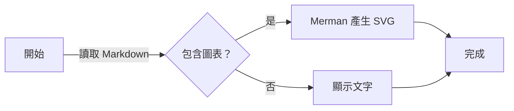
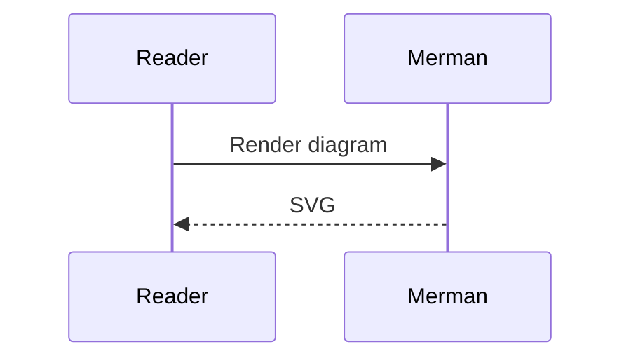
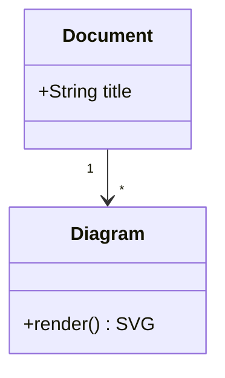
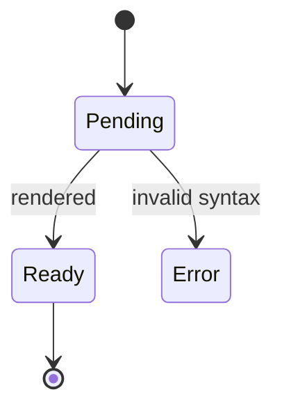
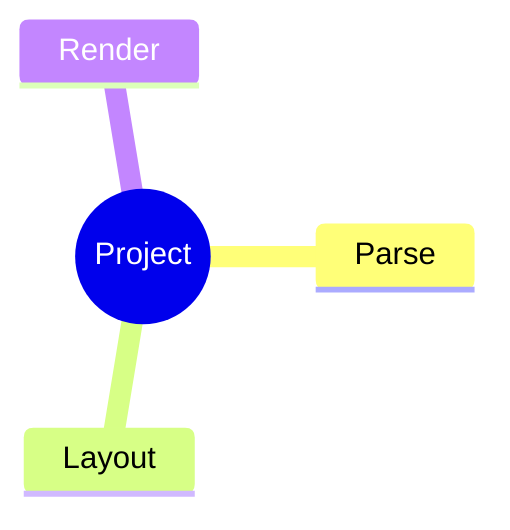
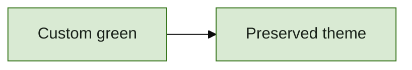
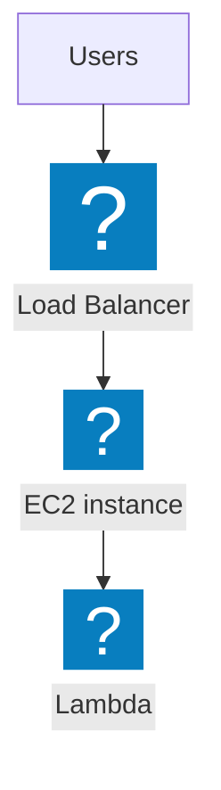

# Merman renderer trial

Open this file in rmdv. Try a light and a dark theme, then click a diagram to
check zoom and pan. Labels, arrows, and node borders should remain readable.

## 中文流程圖



## Sequence



## Class



## State



## Mindmap



## Explicit theme override



## Invalid source

This should show a diagram error without preventing the other diagrams from
rendering.

```mermaid
this is not valid mermaid
```

## AWS icons with ELK

Dagre remains the default. This block selects ELK with an init directive.
Icon packs are bundled; rendering does not fetch icons from the network.


